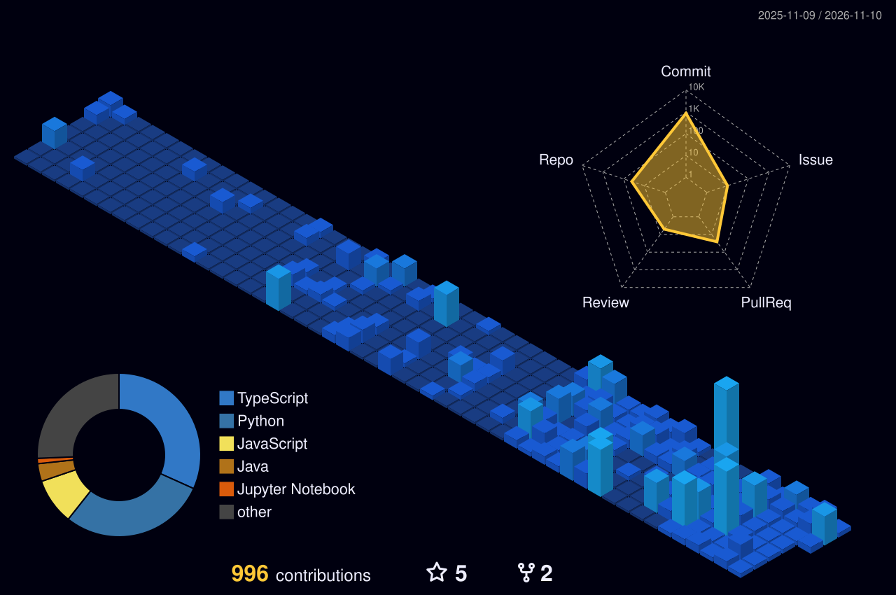

## 🪷 &nbsp; Ātman · *Who I Am*

> ***karmaṇy evādhikāras te mā phaleṣu kadācana***
> *Your right is to the work alone — never to its fruits.* — Bhagavad Gītā 2.47

I'm **Devasish** (aka `TechGen_DM`), a Computer Science & AI student at **Scaler School of Technology** and **BITS Pilani**, Bengaluru. I treat building like a practice, not a performance — show up daily, do the work honestly, let the results take care of themselves.

- 🧘 &nbsp; **Path:** local-first AI — tools that run on your own machine, with nothing leaving your laptop
- ⚙️ &nbsp; **Practice:** automation with n8n, voice agents and LLM pipelines
- 🌐 &nbsp; **Craft:** full-stack products in React, Next.js, TypeScript and Node.js
- 🏁 &nbsp; **Pilgrimages:** hackathons, Kaggle, Hacktoberfest and open source — all built in public
- 🤝 &nbsp; **Open to:** internships, freelance work and hackathon teams

### 📜 &nbsp; My Dev Dharma

| | Principle | In code |
|:-:|---|---|
| 🕊️ | **Satya** — truth | Honest READMEs, real demos, no fake numbers |
| 🌿 | **Ahiṃsā** — do no harm | Privacy first; your data stays on your device |
| 🔥 | **Tapas** — discipline | Ship something every week, even when it's small |
| 🙏 | **Sevā** — service | Build for real people: shopkeepers, students, committees |

## 🔱 &nbsp; Karma · *The Work*

| | Project | What it does | Built with |
|:-:|---|---|---|
| 🔭 | **[OpenField](https://github.com/TechGenDM/OpenField)** | Local-AI engine that turns a curious question into a short real-world investigation | TypeScript · Ollama |
| 🧰 | **[Hack-Day-Starter](https://github.com/TechGenDM/Hack-Day-Starter)** | Reads your hardware, picks the right Ollama model, and generates a ready-to-run starter project | TypeScript · Ollama |
| 🎮 | **[DEAD-AIR](https://github.com/TechGenDM/DEAD-AIR)** | 3D browser mystery game driven by an AI model running locally through WebGPU | TypeScript · WebGPU |
| 💸 | **[LeakLens](https://github.com/TechGenDM/LeakLens)** | Audits finance CSVs, flags cash leaks, and forecasts 90-day cash runway | TypeScript |
| 📒 | **[Mutual-Khata](https://github.com/TechGenDM/Mutual-Khata)** | Offline-first shared credit ledger for Indian retailers and distributors | Kotlin · Android |
| ⚖️ | **[Air-Gapped-RAG](https://github.com/TechGenDM/Air-Gapped-RAG)** | Fully offline RAG pipeline for searching legal PDFs during contract review | Python · RAG |
| 🗄️ | **[Anvil](https://github.com/TechGenDM/Anvil-Conflict-Free-Collaborative-OLTP)** | Conflict-free collaborative OLTP database engine — no central coordinator needed | Python · CRDTs |
| 📞 | **[Voice-Agent-With-Vapi](https://github.com/TechGenDM/Voice-Agent-With-Vapi)** | AI voice receptionist that checks availability and books calendar appointments | Vapi · n8n |
| 🪔 | **[GPMS](https://github.com/TechGenDM/GPMS)** | Donation and expense management for a Ganesh Puja committee | TypeScript · Next.js |

## 📿 &nbsp; Sādhanā · *More of the Path*

<b>🤖 &nbsp;AI apps & automation</b>

 

- **[VidSnap_AI](https://github.com/TechGenDM/VidSnap_AI)** — turns images and text into short vertical videos (Flask, ffmpeg, ElevenLabs)
- **[AI-Learning-Assistant](https://github.com/TechGenDM/AI-Learning-Assistant)** — full-stack MERN app that helps you learn with AI
- **[Jev-DocEval](https://github.com/TechGenDM/Jev-DocEval)** — rubric-based markdown doc evaluation dashboard and CLI
- **[Competitor Ad Spy & UGC Script Cloner](https://github.com/TechGenDM/Competitor-Ad-Spy-UGC-Script-Cloner-n8n-Apify-Gemini-Video-Analysis)** — n8n + Apify + Gemini workflow that analyses competitor video ads and drafts UGC scripts
- **[Divex](https://github.com/TechGenDM/Divex)** / **[Nexus](https://github.com/TechGenDM/Nexus)** — DeepSeek-style and Gemini-style AI chat clones

<b>🛠️ &nbsp;Developer tools</b>

 

- **[getman](https://github.com/TechGenDM/getman)** — lightweight cross-platform desktop app for API testing
- **[Code-Mirror](https://github.com/TechGenDM/Code-Mirror)** — browser code editor with multi-language syntax highlighting
- **[Lumina](https://github.com/TechGenDM/Lumina)** — Chrome extension for full-page screenshots
- **[Free-Perks](https://github.com/TechGenDM/Free-Perks)** — discover and verify free developer perks
- **[DigiTools-dev](https://github.com/TechGenDM/DigiTools-dev)** — converters, formatters and productivity tools in one web app

<b>🌐 &nbsp;Web & mobile apps</b>

 

- **[SettleUp](https://github.com/TechGenDM/SettleUp)** — group expense splitter (React + Firebase)
- **[Pulsr](https://github.com/TechGenDM/Pulsr)** — blood donor search web app
- **[Birthdex-SST](https://github.com/TechGenDM/Birthdex-SST)** — birthday tracker for SST students
- **[ECommerce-App](https://github.com/TechGenDM/ECommerce-App)** — e-commerce mobile app (React Native + Expo)
- **[NameCrafts.in](https://github.com/TechGenDM/NameCrafts.in)** — creative name generator for brands and handles

<b>📊 &nbsp;Data science & hackathons</b>

 

- **[UIDAI_Hackathon](https://github.com/TechGenDM/UIDAI_Hackathon)** — analysis of 1M+ Aadhaar enrolment records for district-level inequality
- **[Aerofit_Casestudy](https://github.com/TechGenDM/Aerofit_Casestudy)** — customer profiling and product recommendations
- **[student-ml-api](https://github.com/TechGenDM/student-ml-api)** — Flask + scikit-learn API for student performance prediction

<b>📚 &nbsp;Learning in public — the daily practice</b>

 

- **[Machine-Learning-Foundation](https://github.com/TechGenDM/Machine-Learning-Foundation)** · **[Deep-Learning-PyTorch](https://github.com/TechGenDM/Deep-Learning-PyTorch)** · **[Mathematics-For-Machine-Learning](https://github.com/TechGenDM/Mathematics-For-Machine-Learning)**
- **[Recommender-Systems](https://github.com/TechGenDM/Recommender-Systems)** · **[Computer-Networks](https://github.com/TechGenDM/Computer-Networks)** · **[AI Automation with n8n](https://github.com/TechGenDM/AI-Automation-And-Agentic-AI-With-n8n)**

## ⚔️ &nbsp; Astra-Śastra · *My Arsenal*

**🗣️ Languages**

**🧠 AI, LLMs & Automation**

**🎨 Frontend & Mobile**

**🏛️ Backend, Data & Systems**

## 🪔 &nbsp; Yātrā · *The Journey So Far*

&nbsp;

## 🙏 &nbsp; Sangha · *Walk With Me*

*The path is better walked together.*
Find me everywhere as **`@TechGen_DM`** — open to internships, freelance projects and hackathon teams.

