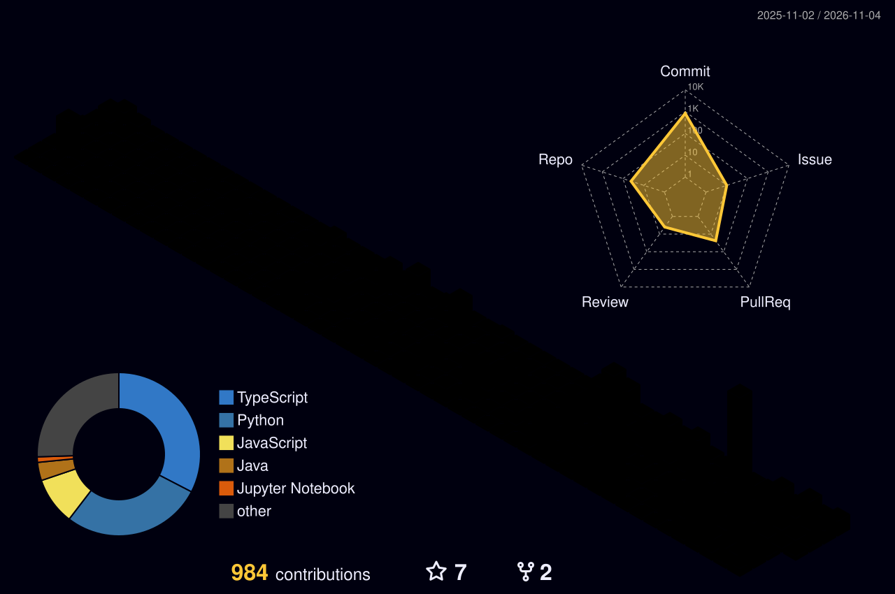

**Jump to:** [Featured Work](#-featured-work) • [More Projects](#-more-projects) • [Tech Stack](#-tech-stack) • [Stats](#-github-stats) • [Connect](#-lets-build-something)

---

## 🧑‍💻 &nbsp; Hey, I'm Devasish — aka `TechGen_DM`

- 🎓 &nbsp; CS & AI student at **Scaler School of Technology** (2025–29) and **BITS Pilani** (2025–28), Bengaluru
- 🤖 &nbsp; Building **local-first AI** — tools that run on your own machine, no cloud bill, no data leaving the laptop
- ⚙️ &nbsp; Automating real work with **n8n, voice agents and LLM pipelines**
- 🌐 &nbsp; Shipping full-stack products with **React, Next.js, TypeScript and Node.js**
- 🏁 &nbsp; Hackathons, Kaggle, Hacktoberfest and open source — all built in public
- 🤝 &nbsp; Open to internships, freelance work and collabs — reach me **@TechGen_DM** anywhere

---

## 🚀 &nbsp; Featured Work

| Project | What it does | Built with |
|---|---|---|
| 🔭 **[OpenField](https://github.com/TechGenDM/OpenField)** | Local-AI engine that turns a curious question into a short real-world investigation | TypeScript · Ollama |
| 🧰 **[Hack-Day-Starter](https://github.com/TechGenDM/Hack-Day-Starter)** | Reads your hardware, picks the right Ollama model, and generates a ready-to-run starter project | TypeScript · Ollama |
| 🎮 **[DEAD-AIR](https://github.com/TechGenDM/DEAD-AIR)** | 3D browser mystery game driven by an AI model running locally through WebGPU | TypeScript · WebGPU |
| 💸 **[LeakLens](https://github.com/TechGenDM/LeakLens)** | Audits finance CSVs, flags cash leaks, and forecasts 90-day cash runway | TypeScript |
| 📒 **[Mutual-Khata](https://github.com/TechGenDM/Mutual-Khata)** | Offline-first shared credit ledger for Indian retailers and distributors | Kotlin · Android |
| ⚖️ **[Air-Gapped-RAG](https://github.com/TechGenDM/Air-Gapped-RAG)** | Fully offline RAG pipeline for searching legal PDFs during contract review | Python · RAG |
| 🗄️ **[Anvil](https://github.com/TechGenDM/Anvil-Conflict-Free-Collaborative-OLTP)** | Conflict-free collaborative OLTP database engine — no central coordinator needed | Python · CRDTs |
| 📞 **[Voice-Agent-With-Vapi](https://github.com/TechGenDM/Voice-Agent-With-Vapi)** | AI voice receptionist that checks availability and books calendar appointments | Vapi · n8n |

---

## 🧩 &nbsp; More Projects

<b>🤖 AI apps & automation</b>

 

- **[VidSnap_AI](https://github.com/TechGenDM/VidSnap_AI)** — turns images and text into short vertical videos (Flask, ffmpeg, ElevenLabs)
- **[AI-Learning-Assistant](https://github.com/TechGenDM/AI-Learning-Assistant)** — full-stack MERN app that helps you learn with AI
- **[Jev-DocEval](https://github.com/TechGenDM/Jev-DocEval)** — rubric-based markdown doc evaluation dashboard and CLI
- **[Competitor Ad Spy & UGC Script Cloner](https://github.com/TechGenDM/Competitor-Ad-Spy-UGC-Script-Cloner-n8n-Apify-Gemini-Video-Analysis)** — n8n + Apify + Gemini workflow that analyses competitor video ads and drafts UGC scripts
- **[Divex](https://github.com/TechGenDM/Divex)** / **[Nexus](https://github.com/TechGenDM/Nexus)** — DeepSeek-style and Gemini-style AI chat clones

<b>🛠️ Developer tools</b>

 

- **[getman](https://github.com/TechGenDM/getman)** — lightweight cross-platform desktop app for API testing
- **[Code-Mirror](https://github.com/TechGenDM/Code-Mirror)** — browser code editor with multi-language syntax highlighting
- **[Lumina](https://github.com/TechGenDM/Lumina)** — Chrome extension for full-page screenshots
- **[Free-Perks](https://github.com/TechGenDM/Free-Perks)** — discover and verify free developer perks
- **[DigiTools-dev](https://github.com/TechGenDM/DigiTools-dev)** — converters, formatters and productivity tools in one web app

<b>🌐 Web & mobile apps</b>

 

- **[GPMS](https://github.com/TechGenDM/GPMS)** — donation and expense management for a Ganesh Puja committee
- **[SettleUp](https://github.com/TechGenDM/SettleUp)** — group expense splitter (React + Firebase)
- **[Pulsr](https://github.com/TechGenDM/Pulsr)** — blood donor search web app
- **[Birthdex-SST](https://github.com/TechGenDM/Birthdex-SST)** — birthday tracker for SST students
- **[ECommerce-App](https://github.com/TechGenDM/ECommerce-App)** — e-commerce mobile app (React Native + Expo)
- **[NameCrafts.in](https://github.com/TechGenDM/NameCrafts.in)** — creative name generator for brands and handles

<b>📊 Data science & hackathons</b>

 

- **[UIDAI_Hackathon](https://github.com/TechGenDM/UIDAI_Hackathon)** — analysis of 1M+ Aadhaar enrolment records for district-level inequality
- **[Aerofit_Casestudy](https://github.com/TechGenDM/Aerofit_Casestudy)** — customer profiling and product recommendations
- **[student-ml-api](https://github.com/TechGenDM/student-ml-api)** — Flask + scikit-learn API for student performance prediction

<b>📚 Learning in public</b>

 

- **[Machine-Learning-Foundation](https://github.com/TechGenDM/Machine-Learning-Foundation)** · **[Deep-Learning-PyTorch](https://github.com/TechGenDM/Deep-Learning-PyTorch)** · **[Mathematics-For-Machine-Learning](https://github.com/TechGenDM/Mathematics-For-Machine-Learning)**
- **[Recommender-Systems](https://github.com/TechGenDM/Recommender-Systems)** · **[Computer-Networks](https://github.com/TechGenDM/Computer-Networks)** · **[AI Automation with n8n](https://github.com/TechGenDM/AI-Automation-And-Agentic-AI-With-n8n)**

---

## 🎨 &nbsp; Tech Stack

**Languages**

**AI, LLMs & Automation**

**Frontend & Mobile**

**Backend & Data**

**Systems & Tools**

---

## 📊 &nbsp; GitHub Stats

&nbsp;

<picture>
  <source media="(prefers-color-scheme: dark)" srcset="https://raw.githubusercontent.com/TechGenDM/TechGenDM/output/github-contribution-grid-snake-dark.svg"/>
  
</picture>

---

## 🤝 &nbsp; Let's Build Something

**Find me everywhere as** `@TechGen_DM` — open to internships, freelance projects and hackathon teams.

